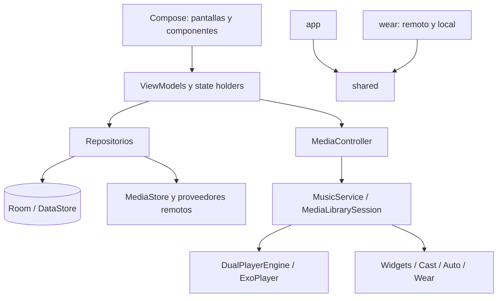

# Arquitectura y puntos de entrada

## Cómo está dividido

El proyecto es una aplicación Android organizada por capas y funciones, con dos aplicaciones instalables y un módulo de contratos. No hay un módulo `domain` separado ni evidencia suficiente para describirlo como Clean Architecture estricta. MVVM, repositorios, Hilt, coroutines y Flow son patrones visibles, con coordinación considerable en `MusicService` y `PlayerViewModel`.

| Módulo | Responsabilidad | Fuente propietaria |
| --- | --- | --- |
| `app` | Aplicación de teléfono: biblioteca, reproducción, UI, proveedores y comunicación con reloj | [build](../app/build.gradle.kts), [manifest](../app/src/main/AndroidManifest.xml) |
| `shared` | DTO serializables, rutas y constantes del protocolo Wear | [build](../shared/build.gradle.kts), [contratos](../shared/src/main/java/com/theveloper/pixelplay/shared) |
| `wear` | Aplicación Wear OS, control remoto y reproducción de archivos locales | [build](../wear/build.gradle.kts), [manifest](../wear/src/main/AndroidManifest.xml) |
| `baselineprofile` | Generación de perfiles y macrobenchmarks sobre `app` | [build](../baselineprofile/build.gradle.kts), [fuentes](../baselineprofile/src/main/java/com/theveloper/pixelplay/baselineprofile) |

`app` y `wear` consumen `shared`; `baselineprofile` apunta a `:app`. Las inclusiones efectivas están en [settings.gradle.kts](../settings.gradle.kts). La configuración de plugins y dependencias se centraliza en [libs.versions.toml](../gradle/libs.versions.toml), con políticas adicionales en [build.gradle.kts](../build.gradle.kts).

El diagrama resume responsabilidades; no representa cada dependencia Hilt ni todos los mensajes bidireccionales. En particular, el estado vuelve desde Media3 hacia los state holders mediante listeners.

## Qué ocurre al abrir la app

1. Android crea [PixelPlayApplication](../app/src/main/java/com/theveloper/pixelplay/PixelPlayApplication.kt). Configura logging, canal de notificación, observación de ciclo de vida, diagnósticos y tareas iniciales de caché. Proporciona la configuración WorkManager con `HiltWorkerFactory`; el manifest retira el inicializador por defecto.
2. [MainActivity](../app/src/main/java/com/theveloper/pixelplay/MainActivity.kt) monta Compose, observa preferencias y decide el recorrido de setup o la navegación principal. Hay entradas adicionales mediante intents, shortcuts, widgets y controladores de medios.
3. [AppNavigation](../app/src/main/java/com/theveloper/pixelplay/presentation/navigation/AppNavigation.kt) conecta rutas con pantallas. [Screen](../app/src/main/java/com/theveloper/pixelplay/presentation/navigation/Screen.kt) y [MainRootRoutes](../app/src/main/java/com/theveloper/pixelplay/presentation/navigation/MainRootRoutes.kt) describen rutas y clasificación de destinos raíz.
4. ViewModels y state holders consultan repositorios y conectan con Media3 según la función. Abrir una pantalla no implica que todo el catálogo de proveedores deba inicializarse de inmediato: existen dependencias `Lazy` y trabajo diferido.

[ExternalPlayerActivity](../app/src/main/java/com/theveloper/pixelplay/ExternalPlayerActivity.kt) atiende audio externo por intents. No se debe asumir que todo lanzamiento pasa por el mismo flujo de biblioteca.

## Dónde vive cada tipo de responsabilidad

| Directorio de `app/src/main/java/com/theveloper/pixelplay` | Qué buscar allí |
| --- | --- |
| `data/database` | Entidades, DAOs, búsquedas y migraciones |
| `data/repository`, `data/media`, `data/worker`, `data/observer` | Lectura del almacenamiento, metadatos, modelos y sincronización |
| `data/preferences` | Persistencia de ajustes y configuración de funciones |
| `data/audio` | Instantánea de salidas previstas, sesiones/sinks y recuperación acotada de efectos |
| `data/service` | Sesión multimedia, motor, notificaciones, HTTP, Cast, Auto, tiles y Wear |
| `data/backup` | Formatos, validación, planificación y ejecución de restauraciones |
| `data/network` y carpetas por proveedor | Integraciones externas y protocolos |
| `data/diagnostics`, `data/stats` | Medición y estadísticas de uso |
| `di` | Construcción y cualificadores de dependencias Hilt |
| `presentation/viewmodel` | Estado, coordinación de acciones y exposición reactiva a UI |
| `presentation/navigation`, `presentation/screens`, `presentation/components` | Rutas, pantallas y UI reutilizable |
| `presentation/<proveedor>` | Autenticación y dashboards por cuenta |
| `ui/theme`, `ui/glancewidget` | Temas y widgets del launcher |
| `utils` | Utilidades compartidas; revisar su contrato concreto antes de reutilizarlas |

El [índice de código](reference/source-index.md) desglosa todos los directorios y archivos; esta tabla explica sus familias para evitar duplicar ese inventario manualmente.

## Construcción de dependencias y vida útil

[AppModule](../app/src/main/java/com/theveloper/pixelplay/di/AppModule.kt) proporciona Room, DAOs, DataStore, repositorios, clientes HTTP, Coil, token de sesión y scope de aplicación. [Qualifiers](../app/src/main/java/com/theveloper/pixelplay/di/Qualifiers.kt) distingue dependencias del mismo tipo. [BackupModule](../app/src/main/java/com/theveloper/pixelplay/di/BackupModule.kt) registra handlers de backup. Wear tiene su propio [WearModule](../wear/src/main/java/com/theveloper/pixelplay/di/WearModule.kt).

No presupongas que todos los objetos duran lo mismo: hay singletons, scopes de ViewModel, trabajos del servicio y coroutines de UI. Para cambiar un listener o job, identifica quién lo crea, quién lo cancela y qué ocurre al destruir el servicio, salir de la pantalla o reconstruir el player.

## Límites que conviene preservar

- La reproducción duradera pertenece a servicios/sesiones, no al ciclo de vida de una pantalla.
- Las consultas y el escaneo deben respetar dispatchers y mecanismos de paginación existentes; no mover trabajo de disco/red a composición.
- Los contratos serializados de `shared` afectan a dos aplicaciones. Un cambio aparentemente local puede romper una contraparte con versión distinta.
- Modelos UI, DTO de transporte y entidades Room tienen propósitos diferentes; no sustituirlos entre sí solo por similitud de campos.
- Un dato persistente requiere revisar migración, backup y consumidores, además de la pantalla que lo usa.

Estas son pautas de modificación derivadas de la estructura, no una certificación de que todo el código ya las cumple. Para una decisión nueva con alternativas significativas, usa un ADR como [el de contexto documental](decisions/0001-context-structure.md).

La decisión de observación de salida y recuperación está en [ADR 0003](decisions/0003-audio-output-observation.md). Las señales de visibilidad de UI no poseen la reproducción del servicio.
