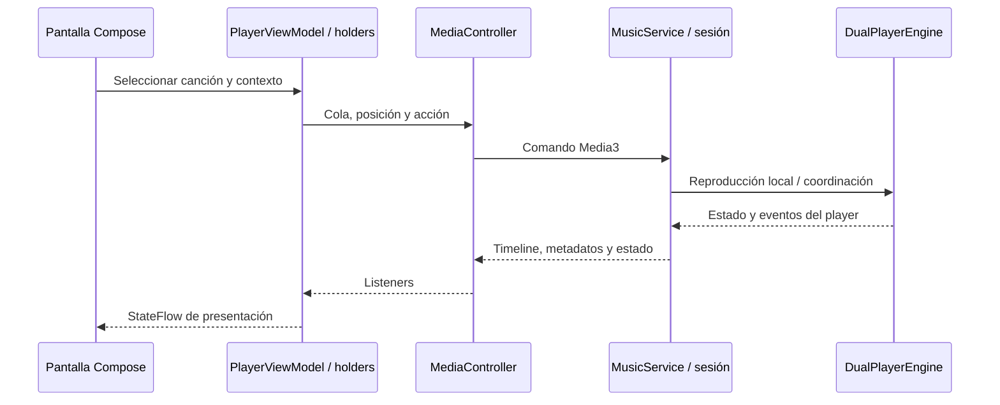

# Reproducción, cola y sesión multimedia

Para cambios orientados al SM-S921B y los receptores personales, consultar [hardware y compatibilidad](hardware/README.md). Esa investigación distingue especificaciones de capacidades negociadas y propone pruebas pendientes; no demuestra que un modo float/offload mejore todas las rutas.

## De un tap al sonido

Un tap en una canción no debería crear un reproductor de pantalla. El flujo principal conecta las acciones de UI con una `MediaController`, la sesión mantenida por `MusicService` y el motor local.

Es una simplificación del recorrido local. Cast y Wear introducen otros transportes y propietarios de reproducción; no interpretar el diagrama como una única implementación universal.

## Propietarios y contratos

| Componente | Responsabilidad | Precaución al modificar |
| --- | --- | --- |
| [PlayerViewModel](../app/src/main/java/com/theveloper/pixelplay/presentation/viewmodel/PlayerViewModel.kt) | Fachada y coordinación de muchos state holders | Leer la delegación antes de añadir otra fuente de estado |
| [PlaybackDispatchStateHolder](../app/src/main/java/com/theveloper/pixelplay/presentation/viewmodel/PlaybackDispatchStateHolder.kt) | Preparar acciones y colas desde biblioteca, favoritos y otros contextos | Conserva orden y cancela solicitudes obsoletas; no limitar la cola a una página visible |
| [MediaControllerFactory](../app/src/main/java/com/theveloper/pixelplay/data/media/MediaControllerFactory.kt) | Construir la conexión asíncrona con Media3 | La conexión no está lista instantáneamente |
| [MediaControllerSyncStateHolder](../app/src/main/java/com/theveloper/pixelplay/presentation/viewmodel/MediaControllerSyncStateHolder.kt) | Listeners, timeline, metadatos y sincronización de estado UI | Desregistrar listeners y evitar reconstrucciones redundantes |
| [PlaybackStateHolder](../app/src/main/java/com/theveloper/pixelplay/presentation/viewmodel/PlaybackStateHolder.kt) | Estado de reproducción y posición | Mantener separados estado estable y emisiones frecuentes |
| [QueueStateHolder](../app/src/main/java/com/theveloper/pixelplay/presentation/viewmodel/QueueStateHolder.kt) y holders de undo | Operaciones de cola y deshacer | Revisar índice actual, identidad, orden y snapshot |
| [MusicService](../app/src/main/java/com/theveloper/pixelplay/data/service/MusicService.kt) | `MediaLibraryService`, sesión, callbacks, ciclo de vida, snapshots, controles externos | Seguridad de controladores, hilo del player y consistencia al intercambiarlo |
| [DualPlayerEngine](../app/src/main/java/com/theveloper/pixelplay/data/service/player/DualPlayerEngine.kt) | ExoPlayer local, resolución de fuentes y transiciones | Audio focus, offload, buffers, índices y liberación de players |

## Estado que cambia a velocidades distintas

[StablePlayerState](../app/src/main/java/com/theveloper/pixelplay/presentation/viewmodel/StablePlayerState.kt) contiene canción actual y estado de reproducción. La posición tiene un `StateFlow<Long>` propio en `PlaybackStateHolder`; `PlayerViewModel.currentPlaybackPosition` lo expone. [PlayerUiState](../app/src/main/java/com/theveloper/pixelplay/presentation/viewmodel/PlayerUiState.kt) contiene otros estados de coordinación, cola y biblioteca.

No reintroducir un tick frecuente en un objeto observado por toda la biblioteca sin justificarlo: podría ampliar la superficie de recomposición. El informe histórico de performance contiene otra fotografía del modelo; usa estos archivos como fuente actual.

## Por qué hay dos players

`DualPlayerEngine` mantiene un player principal y crea el auxiliar para preparar/transicionar hacia el siguiente audio. Durante un crossfade, el player expuesto por la sesión y el que termina de apagarse pueden diferir temporalmente. Hay listeners para intercambio, player mostrado y fin de transición.

No es suficiente mover «la siguiente canción» en una lista: deben coincidir el índice absoluto, la ventana de cola preparada, la metadata expuesta y el audio que se escucha. El motor contiene ventanas de timeline y guardas posteriores a transición, además de políticas de offload y focus. [TransitionController](../app/src/main/java/com/theveloper/pixelplay/data/service/player/TransitionController.kt) y [TransitionRepository](../app/src/main/java/com/theveloper/pixelplay/data/repository/TransitionRepository.kt) son referencias para reglas de transición.

Los ajustes Hi-Fi, ReplayGain, ecualización, downmix y sample-rate cap pueden alterar el pipeline. Sus propietarios incluyen [ReplayGainProcessor](../app/src/main/java/com/theveloper/pixelplay/data/service/ReplayGainProcessor.kt), [EqualizerManager](../app/src/main/java/com/theveloper/pixelplay/data/equalizer/EqualizerManager.kt), [HiResSampleRateCapAudioProcessor](../app/src/main/java/com/theveloper/pixelplay/data/service/player/HiResSampleRateCapAudioProcessor.kt), [SurroundDownmixProcessor](../app/src/main/java/com/theveloper/pixelplay/data/service/player/SurroundDownmixProcessor.kt), [HiFiAudioProcessor](../app/src/main/java/com/theveloper/pixelplay/data/service/player/HiFiAudioProcessor.kt) y [AudioDecoderPolicy](../app/src/main/java/com/theveloper/pixelplay/data/service/player/AudioDecoderPolicy.kt). Cuando `hiFiModeEnabled` está activo, [ObservedAudioSink](../app/src/main/java/com/theveloper/pixelplay/data/audio/ObservedAudioSink.kt) ejecuta la cadena única de procesadores PCM (`HiResSampleRateCapAudioProcessor`, `SurroundDownmixProcessor` y `HiFiAudioProcessor`) antes de entregar `C.ENCODING_PCM_FLOAT` a `DefaultAudioSink`, promoviendo formatos PCM de 16/24/32 bits a coma flotante, aplicando margen de resampler e inter-sample peaks (ISP), compensando el margen dinámico (`requiredHeadroomDb`) de `EqualizerManager` y desactivando el offload de hardware mientras el modo Hi-Fi esté habilitado. Además, `AudioDecoderPolicy` prioriza los decodificadores software de referencia AOSP (`c2.android.*` / `omx.google.*`) frente a los decodificadores software propietarios del fabricante (`c2.sec.*` / `omx.sec.*`), conservándolos como respaldo cuando no exista otra alternativa. No generalizar una capacidad de formato a todos los dispositivos ni deducir resolución física del DAC a partir de `PCM_FLOAT`.

El margen fijo es de 5,5 dB en la familia de 44,1 kHz y de 0,6 dB a 48/96/192 kHz. La rampa de ganancia y la recuperación del limitador se calculan por tiempo para conservar su duración al cambiar de frecuencia. El margen reduce el volumen a igual ajuste del sistema. Ver las [mediciones con los XM5](hardware/validation-and-compatibility.md).

## Persistencia y controles externos

`MusicService` captura y restaura [PlaybackQueueSnapshot](../app/src/main/java/com/theveloper/pixelplay/data/model/PlaybackQueueSnapshot.kt), coordina timers, notificación y escucha de dispositivos. Restaurar una cola no equivale necesariamente a iniciar audio; comprueba `playWhenReady` y el contexto del lanzamiento.

Los items solicitados por controladores se resuelven mediante callbacks y [TrustedMediaItemsResolution](../app/src/main/java/com/theveloper/pixelplay/data/service/TrustedMediaItemsResolution.kt). No aceptar URIs o extras arbitrarios de un cliente externo como si los hubiese generado la UI interna.

Widgets y notificaciones reflejan estado del servicio; Android Auto utiliza un árbol de navegación de medios. Cast cambia la ruta y exige sincronizar el estado remoto. Ver [integraciones](integrations.md) y [Wear](wear-protocol.md) antes de tocar caminos compartidos.

## Verificación apropiada

Hay pruebas unitarias para políticas de decoder, audio focus, offload, buffers, downmix, cola y state holders. Son buenas barreras para lógica extraíble, pero no prueban continuidad audible en hardware real. Para cambios de motor o transición, añade al resultado el dispositivo, la ruta de salida, los formatos y una reproducción del caso original. No afirmar «sin cortes» o una mejora de latencia solo por compilar.

## Base Android 17 y observación de audio

El teléfono usa minSdk 37; Wear/shared mantienen su base 30. `MusicService` utiliza el listener de rechazo de foreground de Media3 y pausa ante rechazo, sin sustituir el handler global de excepciones del hilo principal. La promoción temporal devuelve éxito real; un rechazo de comando termina sin reinicio automático. El motor pausa ambos players cuando se deniega audio focus y cancela la preparación/transición pendiente. Fuera de un crossfade, esta cancelación conserva el volumen actual: no debe pasar por el restablecimiento a `1f` que deshace la atenuación de una transición.

[AudioOutputRepository](../app/src/main/java/com/theveloper/pixelplay/data/audio/AudioOutputRepository.kt) comparte dispositivos disponibles, ruta prevista y observaciones por sesión con el servicio y `DeviceCapabilitiesViewModel`. [ObservedAudioSink](../app/src/main/java/com/theveloper/pixelplay/data/audio/ObservedAudioSink.kt) conserva la delegación de Media3. Las actualizaciones de ruta no reinician ambos players ni recorren la biblioteca.

El ecualizador conserva preferencias y bandas aunque falle una instancia. Su recuperación permite un intento por nueva combinación de revisión de ruta/sesión; un fallo no bloquea todo el proceso. [Decisión y límites](decisions/0003-audio-output-observation.md). El sonido, volumen y perfiles tonales no se ajustan por el nombre de receptor.
